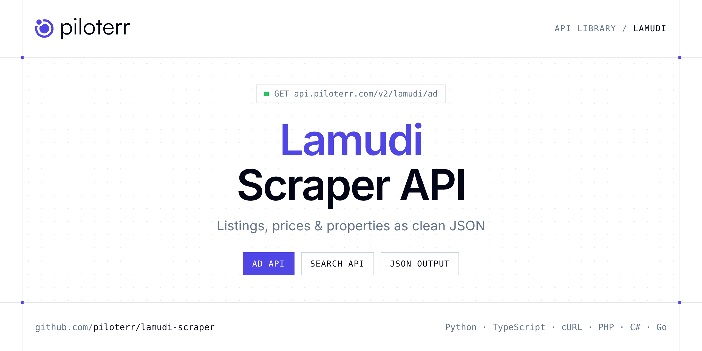

<p align="center">
  <a href="https://www.piloterr.com"></a>
</p>

# Lamudi Scraper API

[](https://discord.gg/CFj3ph8aHU) [](https://app.piloterr.com) [](https://app.piloterr.com/openapi) [](LICENSE)

The **Piloterr Lamudi Scraper API** lets you extract public data from Lamudi as **clean, structured JSON** — no proxies, headless browsers or HTML parsing to maintain. Endpoints available in production:

- **Lamudi Ad API** — Get a full Lamudi listing by URL: price, area, amenities, coordinates, images, and agent (browser rendering, 2 credits).
- **Lamudi Search API** — Search Lamudi Philippines and Indonesia listings.

Use it for property price monitoring, market analytics, investment sourcing or rental yield models.

| Endpoint | Path | Credits | What you get |
|---|---|---|---|
| [Lamudi Ad API](#lamudi-ad-api) | `/v2/lamudi/ad` | 2 | Get a full Lamudi listing by URL |
| [Lamudi Search API](#lamudi-search-api) | `/v2/lamudi/search` | 2 | Search Lamudi Philippines and Indonesia listings. Pass a search URL in `query`, or use `location` and filters. Prices, area, rooms, tags, and pagination via browser rendering (2 credits). |

## Table of contents

- [How it works](#how-it-works)
- [Lamudi Ad API](#lamudi-ad-api)
- [Lamudi Search API](#lamudi-search-api)
- [Code examples in other languages](#code-examples-in-other-languages)
- [Practical use cases](#practical-use-cases)
- [Why Piloterr?](#why-piloterr)
- [FAQ](#faq)
- [Related scrapers](#related-scrapers)
- [Support](#support)

## How it works

1. **Create a free Piloterr account** and copy your API key from the [dashboard](https://app.piloterr.com).
2. **Send a `GET` (or `POST`) request** to `https://api.piloterr.com/v2/...` with the header `x-api-key: YOUR_API_KEY`.
3. **Receive structured JSON** — Piloterr handles rendering, proxies, retries and parsing.

```bash
export PILOTERR_API_KEY="your-api-key"
pip install requests        # Python
# TypeScript: Node.js 18+ (native fetch), run with `npx tsx file.ts`
```

> Every endpoint accepts both `GET` (query string) and `POST` (JSON body with the same fields).

## Lamudi Ad API

Get a full Lamudi listing by URL: price, area, amenities, coordinates, images, and agent (browser rendering, 2 credits).

`GET | POST https://api.piloterr.com/v2/lamudi/ad` · **2 credits per request** · [Full reference](https://app.piloterr.com/openapi)

### Request parameters

| Parameter | Type | Required | Description |
|---|---|---|---|
| `query` | string | ✅ | Full Lamudi listing URL. Accepts `lamudi.com.ph` (`/property/`) and `lamudi.co.id` (`/properti/`). |

### Python example

```python
import json
import os
import requests

response = requests.get(
    "https://api.piloterr.com/v2/lamudi/ad",
    headers={"x-api-key": os.environ["PILOTERR_API_KEY"]},
    params={
        "query": "https://www.lamudi.com.ph/property/41032-73-626c638217d1-1d2a-1985488-907f-7802",
    },
    timeout=60,
)
response.raise_for_status()
data = response.json()

print(json.dumps(data, indent=2, ensure_ascii=False)[:2000])
```

### TypeScript example

```typescript
type LamudiAd = {
  id?: string;
  url?: string;
  area?: {
    lot_m2?: number;
    floor_m2?: number;
  };
  tags?: string[];
  price?: {
    amount?: number;
    currency?: string;
    price_per_m2?: number;
    monthly_estimate?: unknown;
  };
  title?: string;
  images?: string[];
  status?: string;
  country?: string;
  features?: {
    parking?: unknown;
    bedrooms?: number;
    bathrooms?: unknown;
    furnishing?: unknown;
    year_built?: unknown;
    floor_level?: unknown;
  };
  location?: {
    city?: string;
    region?: string;
    latitude?: number;
    longitude?: number;
    full_address?: string;
    neighborhood?: string;
  };
  amenities?: string[];
  operation?: string;
  publisher?: {
    name?: string;
    type?: string;
    phone?: unknown;
    logo_url?: string;
    verified?: boolean;
  };
  thumbnail?: string;
  video_url?: unknown;
  updated_at?: unknown;
  description?: string;
  published_at?: string;
  property_type?: string;
  virtual_tour_url?: unknown;
};

const params = new URLSearchParams({
  "query": "https://www.lamudi.com.ph/property/41032-73-626c638217d1-1d2a-1985488-907f-7802",
});

const response = await fetch(`https://api.piloterr.com/v2/lamudi/ad?${params}`, {
  headers: { "x-api-key": process.env.PILOTERR_API_KEY! },
});
if (!response.ok) throw new Error(`Piloterr error ${response.status}: ${await response.text()}`);

const data = (await response.json()) as LamudiAd;

console.log(JSON.stringify(data, null, 2).slice(0, 2000));
```

<details>
<summary><b>POST variant</b></summary>

```http
POST https://api.piloterr.com/v2/lamudi/ad
x-api-key: YOUR_API_KEY
Content-Type: application/json

{"query": "https://www.lamudi.com.ph/property/41032-73-626c638217d1-1d2a-1985488-907f-7802"}
```
</details>

### Output example

Example response from the API reference, abridged — real values depend on the page you scrape.

```json
{
  "id": "41032-73-626c638217d1-1d2a-1985488-907f-7802",
  "url": "https://www.lamudi.com.ph/property/41032-73-626c638217d1-1d2a-1985488-907f-7802",
  "area": {
    "lot_m2": 250,
    "floor_m2": 100
  },
  "tags": [
    "Fully verified",
    "Featured"
  ],
  "price": {
    "amount": 27650000,
    "currency": "PHP",
    "price_per_m2": 276500,
    "monthly_estimate": null
  },
  "title": "Boracay Newcoast Resort Village Villas",
  "images": [
    "https://img.lamudi.com/eyJidWNrZXQiOiJwcmQtbGlmdWxsY29ubmVjdC1iYWNrZW5kLWIyYi1pbWFnZXMiLCJrZXkiOiJwcm9wZXJ0aWVzLzAxOTg1NDNmLTFjZTEtNzdiOS…",
    "https://img.lamudi.com/eyJidWNrZXQiOiJwcmQtbGlmdWxsY29ubmVjdC1iYWNrZW5kLWIyYi1pbWFnZXMiLCJrZXkiOiJwcm9wZXJ0aWVzLzAxOTg1NDNmLTFjZTEtNzdiOS…"
  ],
  "status": "active",
  "country": "ph",
  "features": {
    "parking": null,
    "bedrooms": 2,
    "bathrooms": null,
    "furnishing": null,
    "year_built": null,
    "floor_level": null
  },
  "location": {
    "city": "Malay",
    "region": "Aklan",
    "latitude": 11.9367774,
    "longitude": 121.9502983,
    "full_address": "Boracay Island, Malay, Lalawigan ng Aklan, Pilipinas",
    "neighborhood": "Boracay Island"
  },
  "amenities": [
    "Fully furnished"
  ],
  "operation": "sale",
  "publisher": {
    "name": "Alessandra Victoria Guingao",
    "type": "agent",
    "phone": null,
    "logo_url": "https://images.proppit.com/publisher/79dfa7ea-beae-11eb-ade2-42010a940008/logo.jpeg",
    "verified": true
  },
  "thumbnail": "https://img.lamudi.com/eyJidWNrZXQiOiJwcmQtbGlmdWxsY29ubmVjdC1iYWNrZW5kLWIyYi1pbWFnZXMiLCJrZXkiOiJwcm9wZXJ0aWVzLzAxOTg1NDNmLTFjZTEtNzdiOS…",
  "video_url": null,
  "updated_at": null,
  "description": "Own a Luxury Villa in Boracay!\n\nMegaworld is now taking LOIs for the Boracay Newcoast Resort Village \n\nVillas – only 23 units available!\n…",
  "published_at": "2025-07-29T00:00:00.000Z",
  "property_type": "house",
  "virtual_tour_url": null
}
```

### Response fields

| Field | Type | Description |
|---|---|---|
| `id` | string |  |
| `url` | string |  |
| `area` | object |  |
| `area.lot_m2` | integer |  |
| `area.floor_m2` | integer |  |
| `tags` | string[] |  |
| `price` | object |  |
| `price.amount` | integer |  |
| `price.currency` | string |  |
| `price.price_per_m2` | integer |  |
| `price.monthly_estimate` | object |  |
| `title` | string |  |
| `images` | string[] |  |
| `status` | string |  |
| `country` | string |  |
| `features` | object |  |
| `features.parking` | object |  |
| `features.bedrooms` | integer |  |
| `features.bathrooms` | object |  |
| `features.furnishing` | object |  |
| `features.year_built` | object |  |
| `features.floor_level` | object |  |
| `location` | object |  |
| `location.city` | string |  |
| `location.region` | string |  |

## Lamudi Search API

Search Lamudi Philippines and Indonesia listings. Pass a search URL in `query`, or use `location` and filters. Prices, area, rooms, tags, and pagination via browser rendering (2 credits).

`GET | POST https://api.piloterr.com/v2/lamudi/search` · **2 credits per request** · [Full reference](https://app.piloterr.com/openapi)

### Request parameters

| Parameter | Type | Required | Description |
|---|---|---|---|
| `query` | string | — | Full Lamudi search URL. Used first when set. Location and path filters are ignored. |
| `location` | string | — | City or district. Used when `query` is empty. Builds a Philippines URL (`lamudi.com.ph`). For Indonesia, pass a search URL in `query`. |
| `operation` | string | — | Transaction type. Used when `query` is empty. |
| `property_type` | string | — | Property type. Used when `query` is empty. Maps to Lamudi slugs (`condominium` → `/condo/`, `land` → `/lot/`). |
| `min_price` | number | — | Minimum asking price in PHP or IDR. |
| `max_price` | number | — | Maximum asking price in PHP or IDR. |
| `min_bedrooms` | number | — | Minimum bedroom count. |
| `max_bedrooms` | number | — | Maximum bedroom count. |
| `min_bathrooms` | number | — | Minimum bathroom count. |
| `min_area` | number | — | Minimum area in m². |
| `max_area` | number | — | Maximum area in m². |
| `sort` | string | — | Sort order. |

### Python example

```python
import json
import os
import requests

response = requests.get(
    "https://api.piloterr.com/v2/lamudi/search",
    headers={"x-api-key": os.environ["PILOTERR_API_KEY"]},
    params={
        "query": "https://www.lamudi.com.ph/buy/metro-manila/makati/condo/",
    },
    timeout=60,
)
response.raise_for_status()
data = response.json()

print(json.dumps(data, indent=2, ensure_ascii=False)[:2000])
```

### TypeScript example

```typescript
type LamudiSearch = {
  results?: {
    id?: string;
    url?: string;
    tags?: string[];
    price?: number;
    title?: string;
    bedrooms?: number;
    currency?: string;
    location?: {
      city?: string;
      region?: string;
      neighborhood?: string;
    };
    bathrooms?: number;
    operation?: string;
    thumbnail?: string;
    lot_area_m2?: unknown;
    published_at?: unknown;
    floor_area_m2?: number;
    property_type?: string;
    publisher_name?: unknown;
  }[];
  pagination?: {
    next?: number;
    current?: number;
    other_pages?: number[];
    total_pages?: number;
    has_next_page?: boolean;
  };
  total_results?: number;
  results_per_page?: number;
};

const params = new URLSearchParams({
  "query": "https://www.lamudi.com.ph/buy/metro-manila/makati/condo/",
});

const response = await fetch(`https://api.piloterr.com/v2/lamudi/search?${params}`, {
  headers: { "x-api-key": process.env.PILOTERR_API_KEY! },
});
if (!response.ok) throw new Error(`Piloterr error ${response.status}: ${await response.text()}`);

const data = (await response.json()) as LamudiSearch;

console.log(JSON.stringify(data, null, 2).slice(0, 2000));
```

<details>
<summary><b>POST variant</b></summary>

```http
POST https://api.piloterr.com/v2/lamudi/search
x-api-key: YOUR_API_KEY
Content-Type: application/json

{"query": "https://www.lamudi.com.ph/buy/metro-manila/makati/condo/"}
```
</details>

### Output example

Example response from the API reference, abridged — real values depend on the page you scrape.

```json
{
  "results": [
    {
      "id": "41032-73-86961cab0c33-7596-4cacf18a-9188-49f0",
      "url": "https://www.lamudi.com.ph/property/41032-73-86961cab0c33-7596-4cacf18a-9188-49f0",
      "tags": [
        "Featured",
        "New Development"
      ],
      "price": 4282813,
      "title": "Condo For Sale in San Antonio",
      "bedrooms": 1,
      "currency": "PHP",
      "location": {
        "city": "Makati",
        "region": "Metro Manila",
        "neighborhood": "Malugay Street"
      },
      "bathrooms": 1,
      "operation": "sale",
      "thumbnail": "https://img.lamudi.com/eyJidWNrZXQiOiJwcmQtbGlmdWxsY29ubmVjdC1iYWNrZW5kLWIyYi1pbWFnZXMiLCJrZXkiOiJpbmdlc3Rlci80Y2FjZjE0MS03NTRkLTQ5YTctOT…",
      "lot_area_m2": null,
      "published_at": null,
      "floor_area_m2": 27,
      "property_type": "condominium",
      "publisher_name": null
    },
    {
      "id": "41032-73-fd54c1228caf-1fa8-1991388-8ea8-7691",
      "url": "https://www.lamudi.com.ph/property/41032-73-fd54c1228caf-1fa8-1991388-8ea8-7691",
      "tags": [
        "Featured",
        "New Development"
      ],
      "price": 6216923,
      "title": "Studio For Sale in San Antonio",
      "bedrooms": 1,
      "currency": "PHP",
      "location": {
        "city": "Makati",
        "region": "Metro Manila",
        "neighborhood": "Malugay Street"
      },
      "bathrooms": 1,
      "operation": "sale",
      "thumbnail": "https://img.lamudi.com/eyJidWNrZXQiOiJwcmQtbGlmdWxsY29ubmVjdC1wcm9qZWN0cy1hZG1pbi1pbWFnZXMiLCJrZXkiOiI1YTZhMjdjYi0zYTc3LTQ2ZmQtYWY4Ni01Nj…",
      "lot_area_m2": null,
      "published_at": null,
      "floor_area_m2": 22,
      "property_type": "condominium",
      "publisher_name": null
    }
  ],
  "pagination": {
    "next": 2,
    "current": 1,
    "other_pages": [
      2,
      3
    ],
    "total_pages": 282,
    "has_next_page": true
  },
  "total_results": 8435,
  "results_per_page": 30
}
```

### Response fields

| Field | Type | Description |
|---|---|---|
| `results[]` | object[] |  |
| `results[].id` | string |  |
| `results[].url` | string |  |
| `results[].tags` | string[] |  |
| `results[].price` | integer |  |
| `results[].title` | string |  |
| `results[].bedrooms` | integer |  |
| `results[].currency` | string |  |
| `results[].location` | object |  |
| `results[].bathrooms` | integer |  |
| `results[].operation` | string |  |
| `results[].thumbnail` | string |  |
| `results[].lot_area_m2` | object |  |
| `results[].published_at` | object |  |
| `results[].floor_area_m2` | integer |  |
| `results[].property_type` | string |  |
| `results[].publisher_name` | object |  |
| `pagination` | object |  |
| `pagination.next` | integer |  |
| `pagination.current` | integer |  |
| `pagination.other_pages` | integer[] |  |
| `pagination.total_pages` | integer |  |
| `pagination.has_next_page` | boolean |  |
| `total_results` | integer |  |
| `results_per_page` | integer |  |

## Code examples in other languages

Ready-to-run examples live in the [`examples/`](examples) folder. Each one reads your key from the `PILOTERR_API_KEY` environment variable.

| Language | Ad | Search |
|---|---|---|
| cURL (Bash) | [`ad`](examples/curl/ad.sh) | [`search`](examples/curl/search.sh) |
| PHP | [`ad`](examples/php/ad.php) | [`search`](examples/php/search.php) |
| C# | [`ad`](examples/csharp/Ad.cs) | [`search`](examples/csharp/Search.cs) |
| Go | [`ad`](examples/go/ad.go) | [`search`](examples/go/search.go) |
| Java | [`ad`](examples/java/AdExample.java) | [`search`](examples/java/SearchExample.java) |
| Ruby | [`ad`](examples/ruby/ad.rb) | [`search`](examples/ruby/search.rb) |
| Node.js | [`ad`](examples/nodejs/ad.mjs) | [`search`](examples/nodejs/search.mjs) |

## Practical use cases

- **Price monitoring** — Track asking prices and price drops per area.
- **Market analytics** — Measure inventory, days on market and price per m² / sqft.
- **Investment sourcing** — Detect undervalued properties as soon as they are listed.
- **Rental yield models** — Combine sale and rent listings to estimate yields.
- **Proptech products** — Power portals, valuation tools and alerts with structured listings.

## Why Piloterr?

- **No infrastructure** — no proxies, headless browsers or CAPTCHA solving to run yourself.
- **Structured JSON** — stable, documented fields instead of brittle HTML selectors.
- **Pay per request** — transparent credit cost per endpoint, failed requests are retried for you.
- **One API key, hundreds of sources** — Lamudi plus many other e-commerce, search and company data endpoints in the [Piloterr library](https://www.piloterr.com/library).
- **Any language** — plain HTTPS + JSON, with examples for Python, TypeScript, cURL, PHP, C#, Go, Java, Ruby and Node.js.

## FAQ

### Is it legal to scrape Lamudi?

Collecting publicly available data is generally allowed in many jurisdictions, but rules depend on your country, the data you collect and how you use it. Avoid personal data unless you have a lawful basis, respect the website's terms where they apply, and get legal advice for your specific use case. This is not legal advice.

### Do I need proxies or a headless browser?

No. Piloterr handles rendering, proxy rotation and retries on its side. You only send an HTTPS request with your `x-api-key` header and receive JSON.

### How much does a request cost?

Credits per call: `/v2/lamudi/ad` **2**, `/v2/lamudi/search` **2**. See the [Piloterr website](https://www.piloterr.com) for plans.

### What data does the Lamudi API return?

Each endpoint returns structured JSON: **Lamudi Ad** — `id`, `url`, `area`, `area.lot_m2`, `area.floor_m2`, `tags`; **Lamudi Search** — `results[]`, `results[].id`, `results[].url`, `results[].tags`, `results[].price`, `results[].title`.

### Which languages are supported?

Any language that can make an HTTP request. This README shows Python and TypeScript; the [`examples/`](examples) folder contains cURL, PHP, C#, Go, Java, Ruby and Node.js.

## Related scrapers

- [Apartments Scraper API](https://github.com/piloterr/apartments-scraper)
- [Argenprop Scraper API](https://github.com/piloterr/argenprop-scraper)
- [Centris Scraper API](https://github.com/piloterr/centris-scraper)
- [Fotocasa Scraper API](https://github.com/piloterr/fotocasa-scraper)
- [Funda Scraper API](https://github.com/piloterr/funda-scraper)
- [Homestra Scraper API](https://github.com/piloterr/homestra-scraper)
- [All Piloterr scrapers on GitHub](https://github.com/piloterr)

## Support

- 💬 Join the [Piloterr Discord](https://discord.gg/CFj3ph8aHU) to ask questions and share what you build.
- 📚 Browse the [API reference (OpenAPI)](https://app.piloterr.com/openapi) and the [Piloterr library](https://www.piloterr.com/library).
- 🔑 [Get your API key](https://app.piloterr.com).

---

<p align="center">
  <a href="https://www.piloterr.com">
    <picture>
      <source media="(prefers-color-scheme: dark)" srcset="images/logo-dark.svg">
      
    </picture>
  </a>
  <br>
  <sub>Built by <a href="https://www.piloterr.com">Piloterr</a> — web scraping APIs for e-commerce, search, real estate and more, one API key.</sub>
</p>

<sub>Lamudi is a trademark of its respective owner. This repository is not affiliated with or endorsed by Lamudi. Examples are released under the MIT license.</sub>
